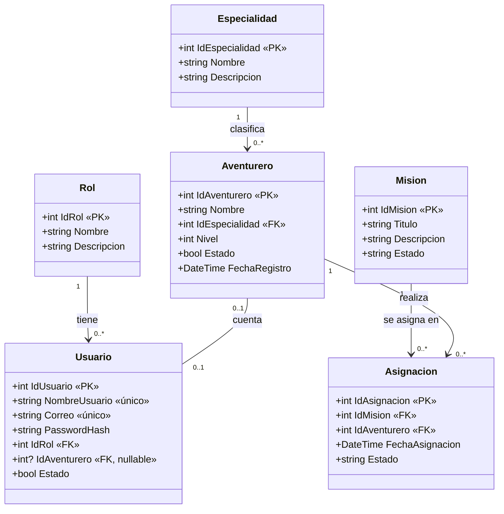

# D2. El conocimiento de la Guilda debe estar organizado — Diagrama de clases (Hechicero)

> Las clases Mision y Asignacion corresponden a la expansión indicada en el desafío; no forman parte de las misiones 1 y 2 implementadas.

## Explicación individual (borrador — adáptalo con tus palabras)

- **Especialidad 1 — * Aventurero:** una especialidad (p. ej. Mago) agrupa a muchos aventureros; cada aventurero tiene exactamente una (FK `IdEspecialidad`).
- **Rol 1 — * Usuario:** un rol (p. ej. Administrador) se asigna a muchos usuarios; todo usuario tiene un rol obligatorio.
- **Aventurero 0..1 — 0..1 Usuario:** un aventurero puede tener una cuenta para ingresar al sistema, y un usuario puede (o no) estar vinculado a un aventurero. El administrador no es aventurero, por eso `IdAventurero` es nullable; pero el usuario con rol Aventurero debe estar vinculado (regla de negocio y restricción CHECK).
- **Misión 1 — * Asignación:** una misión puede requerir a varios aventureros (o repetirse en el tiempo), y cada asignación registra a quién y cuándo; por eso la misión se relaciona con varias asignaciones.
- **Aventurero 1 — * Asignación:** un aventurero puede realizar muchas misiones a lo largo del tiempo. Asignación resuelve la relación muchos a muchos entre Misión y Aventurero.
- **Por qué un usuario puede vincularse a un aventurero:** la cuenta (Usuario) es la identidad de acceso al sistema; el Aventurero es el miembro de la Guilda. Cuando un miembro necesita ingresar, su cuenta apunta a su registro (`IdAventurero`), de modo que el sistema sepa qué misiones y datos le corresponden. Perfiles como Administrador o Maestro no son aventureros, por eso el vínculo es opcional.
